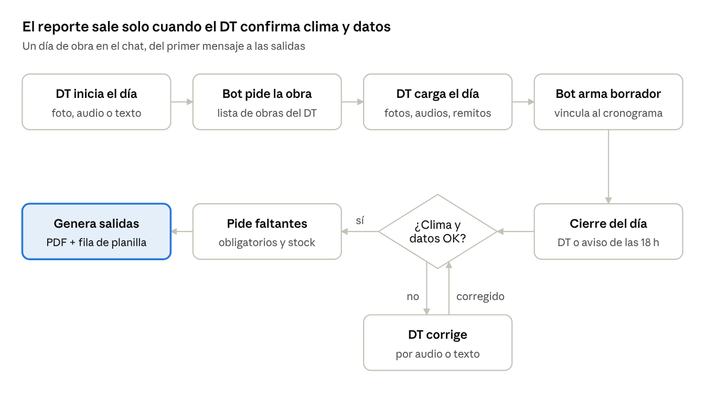

# obra-report-w

Asistente de reporte diario de obra por WhatsApp para directores técnicos (DT).

El DT manda fotos y audios del día; el bot arma un reporte estándar vinculado al cronograma de obra, genera un PDF para el director de proyectos y filas para la planilla de seguimiento de gerencia, y anticipa los pedidos de materiales para que la obra no se detenga.

## Documentación

- [Estándar del reporte diario](docs/ESTANDAR_REPORTE_DIARIO.md): campos del reporte, notas de obra, contexto Tucumán, previsión de materiales, salidas, infraestructura, modos de funcionamiento y MVP.
- [Demo en Telegram](docs/DEMO_TELEGRAM.md): cómo levantarlo y guion para mostrarlo.
- [Bot por WhatsApp](docs/WHATSAPP.md): configuración en Meta, instalación en el VPS, alta del equipo y prueba.

## Estructura

| Archivo | Qué hace |
|---|---|
| `obra_bot/nucleo.py` | Lógica común a los canales: obra del día, borrador, fotos, audios, turnos y cierre |
| `obra_bot/telegram_bot.py` | Canal Telegram: texto, audios, fotos, botones y recordatorio de las 18 h |
| `obra_bot/whatsapp_bot.py` | Canal WhatsApp: webhook de Meta, lista de obras, botones, PDF y recordatorio |
| `obra_bot/whatsapp_api.py` | Cliente de la API de WhatsApp Cloud |
| `obra_bot/equipo.py` | Quién puede usar el bot por WhatsApp y en qué obras (`data/equipo.json`) |
| `obra_bot/agente.py` | Conversación con el modelo de IA (OpenAI o Claude) y descripción automática de fotos |
| `obra_bot/herramientas.py` | Herramientas que usa el modelo: cargar el reporte y consultar cómo viene la obra |
| `obra_bot/reporte.py` | Borrador del día, campos faltantes y confirmación |
| `obra_bot/cronograma.py` | Cronograma, días hábiles, avance previsto y alertas de materiales |
| `obra_bot/salidas.py` | PDF para el director y filas de la planilla de seguimiento |
| `obra_bot/clima.py` | Clima del día por ubicación (Open-Meteo) |
| `obra_bot/transcripcion.py` | Audios a texto (OpenAI, faster-whisper local o Groq) |
| `scripts/seed_demo.py` | Dos obras demo en Tucumán con cronograma (`--historial`: reportes de días anteriores) |
| `scripts/equipo.py` | Alta de personas y asignación de obras (con vencimiento para reemplazos) |
| `tests/` | Pruebas con Meta, el modelo y el clima simulados |

## Estado

Demo funcional en Telegram. Canal WhatsApp listo para probar con el número de prueba de Meta (`python main.py whatsapp`).
Además del reporte, el bot responde consultas sobre la obra (por ejemplo, para un DT que hace un reemplazo).
Para usarlo con todos los DT faltan el número propio del estudio y la verificación del negocio en Meta.
