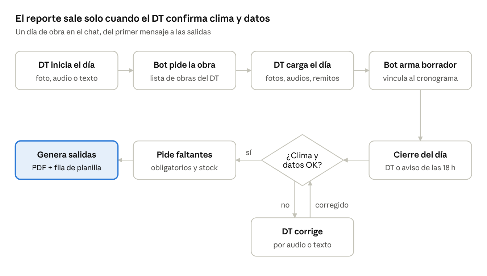

# obra-report-w

Asistente de reporte diario de obra por WhatsApp para directores técnicos (DT).

El DT manda fotos y audios del día; el bot arma un reporte estándar vinculado al cronograma de obra, genera un PDF para el director de proyectos y filas para la planilla de seguimiento de gerencia, y anticipa los pedidos de materiales para que la obra no se detenga.

## Documentación

- [Estándar del reporte diario](docs/ESTANDAR_REPORTE_DIARIO.md): campos del reporte, notas de obra, contexto Tucumán, previsión de materiales, salidas, infraestructura, modos de funcionamiento y MVP.

## Estado

Etapa de definición. Próximo paso: piloto con el número de prueba de WhatsApp Cloud API y 1 o 2 DT.
